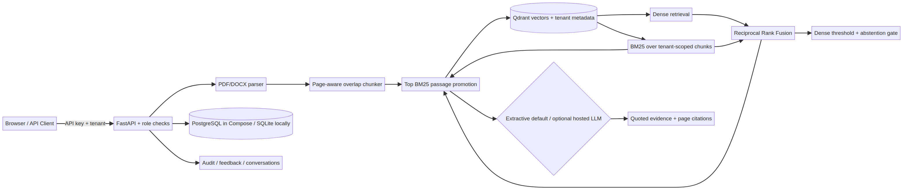

# Engineering Document Intelligence & Grounded RAG

A small, runnable engineering knowledge assistant for retrieval over technical and operational-technology documentation. The minimum vertical workflow is real public source PDF → page-aware parsing/chunking → CPU embedding and Qdrant vector storage → BM25 + dense reciprocal-rank fusion → extractive, citation-linked answer or abstention → tenant-scoped API and browser UI.

This is a portfolio research implementation, not an approved NIST product and not an engineering, safety, security, or regulatory authority. It does not claim affiliation with L&T or use L&T branding or proprietary documents. Human experts must verify source material before operational decisions.

## Features and design

The application ingests PDF and DOCX, extracts PDF page provenance and DOCX paragraphs/tables, hashes files for duplicate detection, versions changed files, and indexes 220-word windows with configurable 40-word overlap. Qdrant stores 384-dimensional ONNX embeddings and chunk metadata. The hybrid ranker combines cosine dense retrieval with a transparent custom BM25 implementation using balanced reciprocal rank fusion (RRF constant 60). For /ask, the top BM25 passage is promoted ahead of the balanced-RRF results; the extractive answer quotes up to three selected passages and links each to its source title, PDF page and chunk ID. A calibrated dense similarity threshold produces an explicit abstention. The UI supports upload, search/ask, citations, conversation history and feedback. API-key roles and tenant filters are enforced in the backend; all document, vector, chat, feedback and audit lookups are tenant-scoped.

The default answer mode is intentionally extractive. An OpenAI-compatible chat-completions adapter is available but is disabled unless `LLM_PROVIDER=openai-compatible` is explicitly configured with `OPENAI_API_KEY`; it is not exercised in the reported run. Provider output must cite retrieved chunk IDs and is rejected if it cites unknown IDs. This avoids using any ambient credential implicitly. The extractive mode avoids unsupported paraphrases but can return long passages. A cross-encoder reranker is not implemented. Qdrant local mode and SQLite are used for the fastest development setup; Compose uses Qdrant and PostgreSQL. The production Compose path is supplied but could not be executed in this runner because Docker is unavailable.

## Architecture



Full editable diagram: [`docs/architecture.mmd`](docs/architecture.mmd). Stack: Python 3.12, FastAPI/Pydantic, SQLAlchemy 2, Qdrant, FastEmbed/ONNX Runtime, pypdf, python-docx, pytest, and Ruff. A direct implementation was selected to keep indexing/retrieval inspectable and avoid unnecessary orchestration dependencies.

## Corpus and model provenance

Seed data is NIST SP 800-82 Rev. 3, *Guide to Operational Technology (OT) Security* (September 2023), from the U.S. National Institute of Standards and Technology. NIST’s front matter states it can be used voluntarily by nongovernmental organizations and is not subject to U.S. copyright, with attribution appreciated. NIST general reuse guidance distinguishes employee works from third-party works and warns that some third-party works may be protected. The publication acknowledges MITRE, CPNI, and ISA contributions/material. For that reason, the source PDF and full extracted text are not in Git; review third-party notices and jurisdiction-specific rights before redistribution or non-U.S. use. Source URLs, retrieved date, size, SHA-256 and processing constraints are recorded in [`data/manifest.json`](data/manifest.json) and [`docs/DATASET.md`](docs/DATASET.md). The PDF is 8,584,345 bytes (8.6 MB), 316 PDF pages, SHA-256 `608f554514d381853e24e0b33123b7080fbd757826f460032690aade63394616` for the retrieved copy dated 2026-10-28.

The embedding model is `BAAI/bge-small-en-v1.5` (MIT, 384 dimensions, 67 MB upstream size), executed via FastEmbed/ONNX on CPU. Model weights download to the normal external cache on first use. No generative LLM weights or GPU are required. See the model card at <https://huggingface.co/BAAI/bge-small-en-v1.5> and source terms in [`docs/DATASET.md`](docs/DATASET.md).

## Local installation and first run

Requirements: Python 3.11+ and network access on first run to download the source PDF and embedding model. Docker is optional for local SQLite and embedded Qdrant mode.

```bash
git clone https://github.com/priyavellanki216/enterprise-document-intelligence-rag.git
cd enterprise-document-intelligence-rag
python -m venv .venv
. .venv/bin/activate
pip install -e '.[test]'
cp .env.example .env
python scripts/download_data.py
python scripts/index_documents.py
uvicorn app.main:app --reload
```

Open <http://127.0.0.1:8000>. Enter the local admin key from `.env.example` to ingest, or viewer key to search. Example query: “What risks remain when using network isolation devices?” The API is documented at `/docs`. Never expose demonstration keys outside local development. For local use only, the default key names are visible in `.env.example`; edit them before shared use.

## Docker Compose

```bash
cp .env.example .env
# Change POSTGRES_PASSWORD and RAG_API_KEYS in .env before exposing the service.
docker compose up --build
```

Compose launches FastAPI, PostgreSQL 16 and Qdrant with named persistent volumes. Compose/Docker is not installed in the current validation environment; use `docker compose config` and a deployment platform’s persistence/secret documentation before publishing. Use TLS and an external secret manager in any shared environment. Do not expose Qdrant or PostgreSQL ports publicly.

## Ingestion and API

The ingestion script downloads only the single canonical handbook and rejects non-PDF files or responses above 25 MB. Upload PDF or DOCX through the UI or `POST /api/v1/documents/upload` with multipart field `file`; an admin API key is required. The API provides liveness/readiness (`/health/live`, `/health/ready`), `/auth/whoami`, document inventory, `/api/v1/search`, `/api/v1/ask`, tenant-scoped conversation history and feedback, and an admin evaluation summary. OpenAPI docs and the complete route list are in [`docs/API.md`](docs/API.md).

PDF pages retain 1-based PDF physical page numbers. DOCX is extracted by paragraph and table; DOCX page numbers cannot be reliably recovered and return `null`. Image-only/scanned PDFs are rejected with a clear message; OCR is not included. Documents are stored outside version control. Unchanged byte-level SHA-256 content is skipped; changed documents with the same name receive an incremented version, and old Qdrant chunks are marked obsolete.

## Evaluation

Evaluation questions are versioned in [`evaluation/questions.json`](evaluation/questions.json). The seven questions include five manually checked answerable questions with page references and two unanswerable prompts; references use 1-based PDF physical pages and not printed page labels. Run:

```bash
python scripts/download_data.py
python scripts/index_documents.py
python scripts/evaluate.py
```

The evaluator compares BM25, dense, and RRF hybrid rankings over the same questions, and reports Recall@5, Precision@5, MRR, nDCG@5, and answerability counts. It writes `reports/evaluation.json`, intentionally ignored by Git because results are environment- and corpus-hash-specific; a checked-in summary with the executed measurements is recorded in [`docs/EVALUATION.md`](docs/EVALUATION.md). This is a small hand-curated diagnostic set, not a statistically representative benchmark. Retrieval metrics use relevant PDF page labels; the automated judge does not measure semantic faithfulness, advice safety, or real-world correctness. Human reviewers should inspect the cited page and exact snippet.

Final executed results on seven queries (five answerable): balanced RRF Recall@5 **0.8000**, Precision@5 **0.2400**, MRR **0.6667**, nDCG@5 **0.9262**; expected citation/abstention behavior **7/7**; exact cited-page/reference agreement **7/15 (0.4667)**; retrieval latency mean **138.87 ms**, p95 **164.70 ms** in the local CPU run. The threshold was tuned on this same tiny question set, making the 7/7 answerability result optimistic and in-sample. See [`docs/EVALUATION.md`](docs/EVALUATION.md) for definitions and limitations.

### Live application smoke test

On 2026-10-28, the final code was run with Uvicorn and exercised over HTTP: `/health/live` returned `ok`, `/health/ready` reported database and vector-store readiness, `/` served the UI, an unauthenticated document-list request returned HTTP 401, and the configured viewer key resolved to the demo tenant. A real `/api/v1/ask` request for “What risks remain when an organization uses network isolation devices?” returned an extractive (non-abstained) answer with three source-backed citations to NIST PDF physical pages 119, 45, and 120. This example also shows why citations require human inspection: only page 120 matched the single manually labeled reference for that question; the measured exact-page rate across the test set is 7/15.

## Tests and security

Run `pytest`, `ruff check app scripts tests`, and `ruff format --check app scripts tests`. CI runs these checks, `pip-audit`, and Gitleaks scanning. A local `pip-audit --skip-editable` run against the patched final third-party environment reported no known vulnerabilities. API keys resolve server-side to roles and tenant IDs; user-controlled tenant identifiers are not accepted. Qdrant filters by tenant and current version; SQL queries filter by tenant. Upload size, file type, PDF encryption, empty documents, API query bounds, key comparison, feedback ratings and conversation ownership are validated. Audit records capture indexing, query, answer, and feedback events without recording API-key values. No SSO, document-level ACL editor, distributed rate limiting, retention automation, malware scanning, or encrypted object store is included. API keys are bearer credentials; local defaults are intentionally insecure and must be replaced. Treat uploads as untrusted. Retrieved document prompt-injection is less applicable to extractive mode, but content is still untrusted and never controls authorization.

## License and limitations

Original code is MIT-licensed (see [`LICENSE`](LICENSE)). Dataset content, model weights, and third-party dependencies retain their own separate terms; see the version-specific [`third-party license and attribution inventory`](docs/THIRD_PARTY_NOTICES.md). The optional PostgreSQL extra pulls an LGPL-3.0 driver for Compose; local SQLite use does not install it. The app does not currently implement OCR, local generative weights, cross-encoder reranking, per-document permission rules, or production-grade identity, key rotation, or rate limits. The optional OpenAI-compatible adapter is not provider-integration-tested here. The simple custom BM25 scoring is designed to be auditable rather than optimized. A local vector DB can keep all uploaded content on the machine. The threshold is a heuristic and may abstain incorrectly. Do not rely on this system for safety-critical decisions.

## Deployment status

No live deployment was attempted: there was no configured hosting target or deployment secret, and Docker is unavailable. Docker Compose is the verified deployment configuration candidate; runtime deployment remains unverified.
